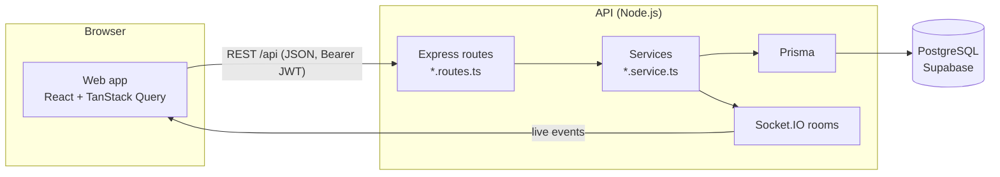

# Architecture

## Overview



Courtside is an npm-workspaces monorepo with two apps:

- **`apps/api`** holds the business rules and the database. It serves a REST API under `/api` and pushes live updates over Socket.IO.
- **`apps/web`** is a single-page React app. In production it's a static bundle served from a CDN or any static host. It holds no business rules beyond what's needed for display, and the API stays the source of truth.

## Backend

```
src/
  server.ts            HTTP + Socket.IO bootstrap, graceful shutdown
  app.ts               middleware: logging, helmet, CORS, JSON, routes, errors
  routes.ts            mounts modules; /health and /auth are public, the rest needs a JWT
  config/env.ts        environment, validated with Zod at start-up
  lib/                 prisma client, logger, HTTP errors, venue time, pricing
  middleware/          auth (JWT, venue roles), validation, error handler
  realtime/socket.ts   rooms and event names
  modules/<area>/      <area>.routes.ts (HTTP) + <area>.service.ts (rules)
```

- **Requests** follow this path: route, then the `validate` middleware (Zod), then a service function, then Prisma. Services never see `req` or `res`, so both sides of the app reuse them. For example, `createBooking` serves both player bookings and staff walk-ins.
- **Errors**: services throw `HttpError(status, message, code)`. The error handler turns every failure into `{ "error": { "code", "message" } }`. `message` is written to be shown to the user, and the web app branches on `code`.
- **Concurrency**: anything that must not double up runs in a serializable transaction. That covers bookings, session capacity and game starts. Postgres exclusion constraints back this up (migration `*_no_overlap_constraints`), so overlapping bookings or blocks are impossible even under races. A violation comes back as `409 SLOT_TAKEN`.
- **Auth**: there's one account type. A user becomes venue staff through the `VenueStaff` table (owner, manager or staff). `requireVenueRole(...)` protects `/business/venues/:venueId/*`. JWTs are stateless and expire after `JWT_EXPIRES_IN`.
- **Logging**: pino writes structured JSON in production and pretty lines in development. Authorization headers and passwords are redacted.
- **Health**: `GET /api/health` checks the database, so load balancers can take an instance out while it can't reach Postgres.

### Database

PostgreSQL, hosted on **Supabase** and used only as a database: accounts and live updates belong to the API. The API connects through Supabase's transaction pooler, and Prisma Migrate uses the session pooler (`DIRECT_URL`). Every table has Row Level Security enabled with no policies, so Supabase's Data API can't reach the data; the API, as table owner, is unaffected. Local development and CI run PostgreSQL 16 in Docker, which behaves the same.

### Data conventions

- **Money** is stored as integer centavos (₱400 = `40000`). There are no floats anywhere.
- **Time** is stored as `timestamptz` in UTC. Each venue has an IANA time zone that defines its opening hours, peak pricing and "today".
- **IDs** are CUIDs.

### Open play queue

The queue sits behind a small interface (`QueueStrategy` in `modules/queue/queue.types.ts`). Open play and games call it on check-in, leave, game start and game end. The rotation rules are pure functions in `modules/queue/rotation.ts`, tested without a database. The `QueueEntry` table stores each checked-in player's state: `WAITING`, `HOLDING` (a winner staying on a court) or `PLAYING`. See [queue-rules.md](queue-rules.md).

### Real-time

Clients connect with `io(url, { auth: { token } })` and join rooms:

| Room           | Who                   | Events                                                   |
| -------------- | --------------------- | -------------------------------------------------------- |
| `session:<id>` | anyone watching       | `lineup:updated`, `game:score`, `session:updated`        |
| `venue:<id>`   | that venue's staff    | `booking:changed`, `schedule:changed`, `session:updated` |
| `user:<id>`    | that user (automatic) | `queue:your-turn`                                        |

The web app treats events as signals: it refetches the affected queries rather than patching state from the payload, so the REST responses stay the single source of truth.

## Frontend

```
src/
  main.tsx, app/       providers (Query, Auth), router, route fallbacks
  lib/                 api client, formatting, realtime hook, cx
  types/api.ts         response shapes from the API
  components/          AppShell, UI kit, CourtDiagram
  features/<area>/     pages and helpers per area: auth, home, booking, openplay, venue
  styles/index.css     Tailwind theme with the Courtside design tokens
```

- **Server state** lives in TanStack Query. Query keys follow the API paths (`['me', 'bookings']`, `['session', id, 'queue']`). Mutations invalidate the keys they affect.
- **Auth** state is in `AuthProvider`. The token and the user summary sit in `localStorage`. Any 401 on an authenticated request signs the user out.
- **Routing**: React Router 7 data router. `RequireAuth` guards the app, and `RequireAuth venue` guards the venue side.
- **Design**: the tokens come from `design/prototype.html`: court blue `#1D4E89`, kitchen green `#3E8E5E`, ball yellow `#F2D43B` and the Archivo font, with light and dark themes. The top-down court diagram is the signature element.
- **Layout**: there's a top navigation bar from the `sm` breakpoint up, and a bottom tab bar on phones.

## Testing strategy

| Level         | Where                                  | Examples                                        |
| ------------- | -------------------------------------- | ----------------------------------------------- |
| Pure rules    | `*.test.ts` next to the code           | pricing, venue time, queue rotation, slot runs  |
| HTTP contract | `apps/api/src/app.test.ts` (Supertest) | error shape, auth, validation, security headers |
| Components    | `apps/web/src/**/*.test.tsx`           | sign-in flow with a mocked API                  |

The next layer to add is integration tests against a real Postgres for the services: CI already provides the database.
