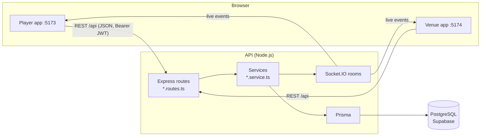

# Architecture

## Overview



Courtside is an npm-workspaces monorepo:

- **`apps/api`** holds the business rules and the database. It serves a REST API under `/api` and pushes live updates over Socket.IO.
- **`apps/player`** and **`apps/venue`** are two single-page React apps: one for players, one for venue owners and staff. Each is a static bundle with its own address, sign-in and release. They hold no business rules beyond what's needed for display; the API stays the source of truth.
- **`packages/client`** and **`packages/ui`** hold the code both apps share. The apps import them as TypeScript source, so there's no package build or publish step.

## Backend

```
src/
  server.ts            HTTP + Socket.IO bootstrap, graceful shutdown
  app.ts               middleware: logging, helmet, CORS, JSON, routes, errors
  routes.ts            mounts modules; /health and /auth are public, the rest needs a JWT
  config/env.ts        environment, validated with Zod at start-up
  lib/                 prisma client, logger, HTTP errors, venue time, pricing
  middleware/          auth (JWT, venue roles), validation, error handler
  realtime/socket.ts   rooms and event names
  modules/<area>/      <area>.routes.ts (HTTP) + <area>.service.ts (rules)
```

- **Requests** follow this path: route, then the `validate` middleware (Zod), then a service function, then Prisma. Services never see `req` or `res`, so both sides of the app reuse them. For example, `createBooking` serves both player bookings and staff walk-ins.
- **Errors**: services throw `HttpError(status, message, code)`. The error handler turns every failure into `{ "error": { "code", "message" } }`. `message` is written to be shown to the user, and the web apps branch on `code`.
- **Concurrency**: anything that must not double up runs in a serializable transaction. That covers bookings, session capacity and game starts. Postgres exclusion constraints back this up (migration `*_no_overlap_constraints`), so overlapping bookings or blocks are impossible even under races. A violation comes back as `409 SLOT_TAKEN`.
- **Auth**: there's one account type. A user becomes venue staff through the `VenueStaff` table (owner, manager or staff). `requireVenueRole(...)` protects `/business/venues/:venueId/*`. JWTs are stateless and expire after `JWT_EXPIRES_IN`.
- **Logging**: pino writes structured JSON in production and pretty lines in development. Authorization headers and passwords are redacted.
- **Health**: `GET /api/health` checks the database, so load balancers can take an instance out while it can't reach Postgres.

### Database

PostgreSQL, hosted on **Supabase** and used only as a database: accounts and live updates belong to the API. The API connects through Supabase's transaction pooler, and Prisma Migrate uses the session pooler (`DIRECT_URL`). Every table has Row Level Security enabled with no policies, so Supabase's Data API can't reach the data; the API, as table owner, is unaffected. Local development and CI run PostgreSQL 16 in Docker, which behaves the same.

### Data conventions

- **Money** is stored as integer centavos (₱400 = `40000`). There are no floats anywhere.
- **Time** is stored as `timestamptz` in UTC. Each venue has an IANA time zone that defines its opening hours, peak pricing and "today".
- **IDs** are CUIDs.

### Open play queue

The queue sits behind a small interface (`QueueStrategy` in `modules/queue/queue.types.ts`). Open play and games call it on check-in, leave, game start and game end. The rotation rules are pure functions in `modules/queue/rotation.ts`, tested without a database. The `QueueEntry` table stores each checked-in player's state: `WAITING`, `HOLDING` (a winner staying on a court) or `PLAYING`. See [queue-rules.md](queue-rules.md).

### Real-time

Clients connect with `io(url, { auth: { token } })` and join rooms:

| Room           | Who                   | Events                                                   |
| -------------- | --------------------- | -------------------------------------------------------- |
| `session:<id>` | anyone watching       | `lineup:updated`, `game:score`, `session:updated`        |
| `venue:<id>`   | that venue's staff    | `booking:changed`, `schedule:changed`, `session:updated` |
| `user:<id>`    | that user (automatic) | `queue:your-turn`                                        |

The web apps treat events as signals: it refetches the affected queries rather than patching state from the payload, so the REST responses stay the single source of truth.

## Frontend

```
apps/player/src/        players: home, booking, open play (port 5173)
apps/venue/src/         owners and staff: dashboard, then schedule, check-ins, scoring (port 5174)
  main.tsx, app/        entry (<Providers side="player" | "venue">), router, route fallbacks
  components/AppShell   the app's navigation, built on the shared shell
  features/<area>/      pages and helpers

packages/client/src/    @courtside/client
  api.ts                fetch client, ApiError, token storage
  auth/                 AuthProvider (signs in as the app's side), useAuth, RequireAuth
  format.ts             pesos, venue-local times, date strip
  realtime.ts           Socket.IO connection + useSessionLive
  apps.ts               URLs of the two apps, for links between them
  types.ts              API response shapes

packages/ui/src/        @courtside/ui
  theme.css             Tailwind theme with the Courtside design tokens
  ui.tsx                UI kit (Button, Card, Field, Chips, Segmented, ...)
  AppShell, SignInForm, AuthLayout, CourtDiagram, Logo
```

- **Why two apps:** players and venue staff use Courtside differently, on different devices, and the venue side will grow into a back-office tool. Separate apps keep player pages light and let each side ship on its own. Both stay in this repository, so an API change and the screens that use it land together.
- **Sign-in:** each app has its own session. The player app signs in with `as: "player"`, the venue app with `as: "venue"`, and the API refuses venue sign-in for accounts without a staff role. Owners who also play get a link to the other app and sign in there too.
- **Server state** lives in TanStack Query. Query keys follow the API paths (`['me', 'bookings']`, `['session', id, 'queue']`). Mutations invalidate the keys they affect. Any 401 on an authenticated request signs the user out.
- **Routing:** a React Router 7 data router in each app. `RequireAuth` guards everything except sign-in; in the venue app it also requires a staff role.
- **Design:** the tokens come from `design/prototype.html`: court blue `#1D4E89`, kitchen green `#3E8E5E`, ball yellow `#F2D43B` and the Archivo font, with light and dark themes. The venue app uses the court-blue header. Each app's CSS adds `@source` for `packages/ui`, so Tailwind generates the shared components' classes.

## Testing strategy

| Level         | Where                                  | Examples                                        |
| ------------- | -------------------------------------- | ----------------------------------------------- |
| Pure rules    | `*.test.ts` next to the code           | pricing, venue time, queue rotation, slot runs  |
| HTTP contract | `apps/api/src/app.test.ts` (Supertest) | error shape, auth, validation, security headers |
| Components    | `apps/*/src/**/*.test.tsx`             | sign-in flows with a mocked API                 |

The next layer to add is integration tests against a real Postgres for the services: CI already provides the database.
